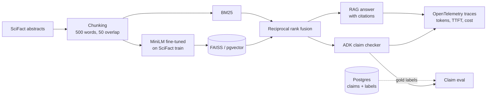

# SciFact Hybrid RAG

[](https://github.com/krishivwahi/scifact-hybrid-rag/actions/workflows/test.yml)

Hybrid BM25 + fine-tuned dense retrieval over 5,183 biomedical abstracts ([BEIR SciFact](https://github.com/beir-cellar/beir)) reaches **0.701 nDCG@10** on 300 expert-labeled test queries, up from 0.663 for BM25 and 0.651 for the off-the-shelf embedding model, and serves grounded, cited answers from a [live demo on Cloud Run](https://scifact-rag-wg3l7sdcsq-uc.a.run.app/).

## Retrieval results (ablation)

300 SciFact test queries, top 10 documents. Run with `python run_eval.py`.

| System | nDCG@10 | P@10 | Recall@10 | MRR | ms/query |
|---|---|---|---|---|---|
| TF-IDF | 0.5835 | 0.0810 | 0.7268 | 0.5522 | 24.6 |
| BM25 | 0.6628 | 0.0863 | 0.7793 | 0.6337 | 3.3 |
| Dense (all-MiniLM-L6-v2) | 0.6512 | 0.0897 | 0.7933 | 0.6126 | 19.8 |
| Hybrid: BM25 + dense (RRF) | 0.6913 | 0.0927 | 0.8219 | 0.6589 | 22.0 |
| Hybrid + cross-encoder rerank | 0.6883 | 0.0917 | 0.8156 | 0.6596 | 3106.1 |
| Dense via pgvector (HNSW) | 0.6512 | 0.0897 | 0.7933 | 0.6126 | 12.8 |
| Dense, fine-tuned on SciFact train | 0.6934 | **0.0957** | **0.8576** | 0.6479 | 26.3 |
| **Hybrid: BM25 + fine-tuned (RRF), served** | **0.7014** | 0.0930 | 0.8322 | **0.6676** | 53.4 |

Latency is measured on a laptop CPU (no GPU) and excludes model loading. The fine-tuned rows were measured while another job shared the CPU, so their latency is inflated.

What the numbers say:

- **BM25 is a strong baseline.** This implementation scores 0.663 nDCG@10, matching the 0.665 reported for BM25 in the [BEIR paper](https://arxiv.org/abs/2104.08663) (Anserini's reproduction gets 0.672; indexing details account for the spread), and it beats the off-the-shelf dense model. TF-IDF is a much weaker comparison point.
- **Hybrid retrieval beats either retriever alone:** +3 nDCG points over BM25 and +4 over base dense. Lexical and semantic retrieval miss different documents, and reciprocal rank fusion combines them without any score calibration.
- **Fine-tuning fixes the dense model.** [finetune.py](finetune.py) trains MiniLM for 3 epochs (16 min on a laptop CPU) on 823 claim→evidence pairs from the SciFact *train* split, using a contrastive loss with in-batch negatives. Hyperparameters were fixed up front, 10% of the train claims were held out for validation (nDCG@10 0.673 → 0.698), and the test set was evaluated once. An independent retrain from scratch scored 0.696 on test (0.694 validation), so run-to-run variation on CPU is about ±0.003. On test, dense goes from 0.651 to **0.693 nDCG@10** (+4.2) and recall@10 from 0.79 to **0.86**, overtaking BM25. Fused with BM25 it reaches **0.701**, the best system here and the one the API serves.
- **The reranker did not help.** `cross-encoder/ms-marco-MiniLM-L-6-v2` is trained on web search queries and does not transfer to biomedical claims. It adds latency for no gain, so the served pipeline is hybrid without reranking.
- **pgvector matches exact search.** The HNSW index in Postgres returns the same quality as exact FAISS search, so the database can replace the in-memory index without losing accuracy.

## About the project

**Live demo:** [scifact-rag on Cloud Run](https://scifact-rag-wg3l7sdcsq-uc.a.run.app/): ask a question or check a claim, with cited abstracts and per-request token, latency and cost stats. The API itself is documented at [`/docs`](https://scifact-rag-wg3l7sdcsq-uc.a.run.app/docs). The first request after it has been idle takes about 30 s while the service wakes up.

The project covers the full path: chunking, sparse and dense retrieval, rank fusion, a Postgres + pgvector store, grounded answers with citations, a multi-agent claim checker built on Google ADK, per-request LLM metrics with OpenTelemetry traces, and a container ready for Cloud Run.

Every design choice is backed by a measurement on the SciFact test set.

## Architecture



## Claim verification: single-shot RAG vs. multi-agent

SciFact claims are labeled SUPPORT, CONTRADICT or NOT ENOUGH INFO against specific abstracts. `eval_claims.py` scores two systems on a fixed sample of dev claims, reading gold labels from Postgres with SQL:

- **Single-shot RAG:** retrieve 5 passages, one LLM call returns a label and cited doc IDs.
- **ADK multi-agent** ([src/agent.py](src/agent.py)):
  - A `SequentialAgent` orchestrator delegates to a **researcher**, which runs a ReAct loop: it decides its own search queries and searches again when results are off-topic.
  - It then hands off to a **verifier → critic** `LoopAgent`, where the critic checks each citation and either approves or sends a critique back (self-reflection, up to 2 rounds).

Reported per system: label accuracy, macro-F1, **citation precision** (the share of cited abstracts that are gold evidence), LLM calls, tokens, latency and $ per claim.

30 dev claims (13 SUPPORT, 5 CONTRADICT, 12 NEI), `gemini-3.1-flash-lite` for both systems, both retrieving from the served hybrid retriever:

| System | Accuracy | Macro-F1 | Citation precision | LLM calls/claim | Tokens/claim | Latency s/claim |
|---|---|---|---|---|---|---|
| **Single-shot RAG** | **0.700** | **0.694** | **0.571** | **1.0** | **1,821** | **13.6** |
| ADK multi-agent | 0.667 | 0.650 | 0.529 | 5.3 | 8,139 | 65.5 |

Both ran on the free tier ($0). Latency includes free-tier queueing, so compare the ratio, not the absolute seconds.

What the numbers say:

- **The multi-agent checker did not beat single-shot RAG.** It used 5.3× the LLM calls, 4.5× the tokens and 4.8× the latency. The two systems disagreed on 7 of 30 claims; single-shot was right on 4 and the agent on 3. That gap is not statistically meaningful, so the honest conclusion is "no gain for about 5× the cost", not "the agent is worse".
- **The difference is in NOT ENOUGH INFO.** Both systems got all 5 CONTRADICT claims right and were within one claim on SUPPORT (9 vs 10 of 13). On NEI claims single-shot was right on 7 of 12 and the agent on 5. The researcher keeps searching until it finds something that looks relevant, and the verifier then tends to commit to SUPPORT or CONTRADICT when it should abstain.
- **Deciding when the evidence is insufficient is the hard part for both systems** (about 50% on NEI, against 100% on CONTRADICT). That points to better abstention, such as calibrated thresholds or NEI-focused prompting, before more agent steps.

`eval_claims.py` runs both systems on each claim back to back and appends finished claims to a progress file, so runs interrupted by free-tier 503s or daily quotas resume without re-running or mixing models.

## Observability

Each answer reports its own cost and speed. [src/rag.py](src/rag.py) streams the completion to measure:

```text
<tokens in>+<tokens out> tokens | TTFT <s> | <s> total | <decode tok/s> | $<cost>
```

The fields are tokens in and out, time to first token, decode speed, and cost (from `LLM_PRICE_IN` / `LLM_PRICE_OUT` per 1M tokens). Retrieval and generation are OpenTelemetry spans, and ADK adds its own spans for each agent, tool and model call. Traces are written to `traces.jsonl` locally; on GCP the exporter can be swapped for Cloud Trace.

## Data layer

`docker compose up -d && python load_pg.py` loads Postgres 17 + pgvector with:

| Table | Contents |
|---|---|
| `chunks` | text, 384-d embedding (HNSW index), generated `tsvector` (GIN index) |
| `claims` | 1,109 SciFact train/dev claims |
| `claim_evidence` | claim → abstract → SUPPORT / CONTRADICT |

The embeddings are copied from the cached FAISS index, so loading never re-embeds the corpus.

## Running it

```bash
pip install -r requirements.txt --extra-index-url https://download.pytorch.org/whl/cpu
python download_data.py
python finetune.py            # fine-tune MiniLM on SciFact train (~16 min on CPU)
python run_eval.py            # retrieval ablation (builds and caches the indexes on first run)
python -m pytest tests        # metric, chunker, BM25 and fusion tests
```

For the LLM parts, create `.env`. Any OpenAI-compatible provider works for `ask.py` and the API; the ADK agent needs a Gemini model. A free [Google AI Studio](https://aistudio.google.com/apikey) key covers both:

```env
LLM_API_KEY=your_key
LLM_BASE_URL=https://generativelanguage.googleapis.com/v1beta/openai/
LLM_MODEL=gemini-3.5-flash-lite
```

```bash
python ask.py                                         # interactive Q&A in the terminal
docker compose up -d && python load_pg.py             # Postgres + pgvector
python eval_claims.py 30                              # claim verification eval on 30 dev claims
```

### HTTP API (Docker)

```bash
docker build -t scifact-rag .
docker run -p 8080:8080 --env-file .env scifact-rag
curl -X POST localhost:8080/ask    -H 'content-type: application/json' -d '{"question": "Does vitamin D reduce fracture risk?"}'
curl -X POST localhost:8080/verify -H 'content-type: application/json' -d '{"claim": "Vitamin D supplementation reduces fractures."}'
```

The image ships with the dataset, FAISS index and model weights already built (CPU-only torch, 2.45 GB), so it serves requests about 12 s after starting.

### Deploying to Cloud Run

This needs a GCP project with billing enabled. Run `python download_data.py` and `python finetune.py` first: the image copies the local corpus, the fine-tuned model and its prebuilt FAISS index, so the build never depends on the dataset host and never re-embeds. Cloud Run scales to zero; `--max-instances 1` caps the worst-case bill.

```bash
PROJECT=$(gcloud config get project); IMG=us-central1-docker.pkg.dev/$PROJECT/rag/scifact-rag:v1
gcloud services enable run.googleapis.com artifactregistry.googleapis.com secretmanager.googleapis.com

# the key goes from .env straight into Secret Manager; a dedicated service account can read only that secret
grep '^LLM_API_KEY=' .env | cut -d= -f2- | tr -d '\r\n ' | gcloud secrets create llm-api-key --data-file=-
gcloud iam service-accounts create scifact-rag-run
gcloud secrets add-iam-policy-binding llm-api-key \
  --member serviceAccount:scifact-rag-run@$PROJECT.iam.gserviceaccount.com --role roles/secretmanager.secretAccessor

gcloud artifacts repositories create rag --repository-format=docker --location=us-central1
gcloud auth configure-docker us-central1-docker.pkg.dev
docker build -t $IMG . && docker push $IMG

gcloud run deploy scifact-rag --image $IMG --region us-central1 \
  --service-account scifact-rag-run@$PROJECT.iam.gserviceaccount.com \
  --cpu 1 --memory 2Gi --cpu-boost --min-instances 0 --max-instances 1 --allow-unauthenticated \
  --set-env-vars LLM_BASE_URL=https://generativelanguage.googleapis.com/v1beta/openai/,LLM_MODEL=gemini-3.5-flash-lite \
  --set-secrets LLM_API_KEY=llm-api-key:latest
```

The API key lives in Secret Manager and is never baked into the image.

## Project layout

| Path | Purpose |
|---|---|
| `src/ingest.py`, `src/dataset.py` | chunking, BEIR loading |
| `src/baseline.py` | TF-IDF and BM25 retrievers |
| `src/embedding.py` | MiniLM + FAISS retriever with an on-disk index cache |
| `finetune.py` | contrastive fine-tuning of MiniLM on SciFact train |
| `src/fusion.py` | reciprocal rank fusion, cross-encoder reranker |
| `src/pgstore.py` | Postgres schema, loader, pgvector retriever |
| `src/rag.py`, `src/telemetry.py` | grounded answers, streaming metrics, tracing |
| `src/agent.py` | ADK multi-agent claim checker |
| `run_eval.py`, `eval_claims.py` | retrieval ablation, claim verification eval |
| `app.py`, `static/index.html`, `Dockerfile` | FastAPI service, demo page, container |

## Limitations

- SciFact is small (5k documents). Exact FAISS search is fast at this size; HNSW in pgvector matters only at larger scales.
- The dense model is a small 22M-parameter encoder, fine-tuned on about 800 pairs. A larger or biomedical base model would likely score higher.
- The agent is Gemini-only through ADK's native client. Other providers need ADK's LiteLLM wrapper.
- Claim-verification results come from a sample of dev claims sized for free-tier rate limits, not the full dev set.
